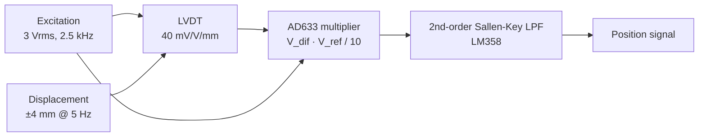

# Sensor Signal Conditioning: MATLAB Models + Proteus Circuits

Signal-conditioning designs for industrial sensors. Each one is modeled in **MATLAB** and built as a circuit in **Proteus**:

1. **LVDT displacement sensor:** AC excitation, synchronous demodulation and low-pass filtering to recover position.
2. **Thermocouple in a noisy furnace:** recovering a 35 mV DC signal buried under 2 V of 60 Hz interference with a hand-designed digital Butterworth filter.
3. **Active filter circuits:** low-pass, high-pass and band-stop stages built with op-amps.

> Coursework, B.Sc. Mechatronics Engineering, Universidad Militar Nueva Granada.

---

## 1. LVDT synchronous demodulation · `matlab/lvdt_synchronous_demodulation.m`

An LVDT outputs an AC signal whose **amplitude** is proportional to the displacement and whose **phase** gives its direction. A plain rectifier loses the direction, but multiplying by the excitation signal (synchronous demodulation) keeps it.

**What the script does:** it generates the excitation, LVDT and demodulated signals at a 100 kHz sampling rate. It then discretizes the analog Sallen-Key filter (R₁ = R₂ = 11 kΩ, C₁ = 220 nF, C₂ = 100 nF) with the **bilinear transform**, reconstructs the displacement, and computes the delay the filter introduces.

| Result | Value |
|---|---|
| Filter cutoff fc | ≈ 97.6 Hz |
| Phase lag at 5 Hz | ≈ 4.0° |
| Time delay at 5 Hz | ≈ 2.2 ms |
| Attenuation of the 5 kHz ripple (2 × fexc) | ≈ −68 dB |

Circuit: `proteus/synchronous_demodulator.pdsprj`

## 2. Thermocouple filtering · `matlab/thermocouple_butterworth_filter.m`

A type-K thermocouple at about 850 °C produces **35.3 mV DC**. Next to the furnace heaters it picks up **2 V peak of 60 Hz** common-mode noise plus white noise.

The script designs a **2nd-order Butterworth low-pass (fc = 5 Hz) by hand**, without the Signal Processing Toolbox. It starts from the analog prototype H(s) = 1/(s² + √2·s + 1) and applies the bilinear transform with frequency pre-warping, K = tan(π fc/fs). It then checks the result:

- DC gain = 1.000 (0 dB), so the temperature reading is not biased.
- Attenuation at 60 Hz ≈ **−43 dB**.
- The script also plots the Bode magnitude, computed directly from H(z) on the unit circle.

## 3. Active filters (Proteus)

| File | Content |
|---|---|
| `proteus/active_filters.pdsprj` | Op-amp active filter stages |
| `proteus/band_stop_filter.pdsprj` | Band-stop (notch-type) filter |
| `proteus/synchronous_demodulator.pdsprj` | AD633-based LVDT demodulator |

## Skills shown

Bilinear transform and pre-warping · IIR filter design from first principles · synchronous (lock-in style) demodulation · Sallen-Key topology · validating designs in both simulation and math.

---

<b>🇪🇸 Versión en español</b>

## Acondicionamiento de señales de sensores (MATLAB y Proteus)

- **LVDT:** demodulación síncrona con el multiplicador AD633 y un filtro Sallen-Key discretizado con la transformada bilineal. fc ≈ 97,6 Hz y retardo de unos 2,2 ms a 5 Hz.
- **Termopar:** filtro Butterworth de segundo orden diseñado a mano (sin el toolbox) con pre-distorsión de frecuencia, para recuperar 35,3 mV con 2 V de ruido de 60 Hz. Atenúa unos −43 dB a 60 Hz.
- **Proteus:** circuitos de filtros activos, rechaza-bandas y demodulador síncrono.

